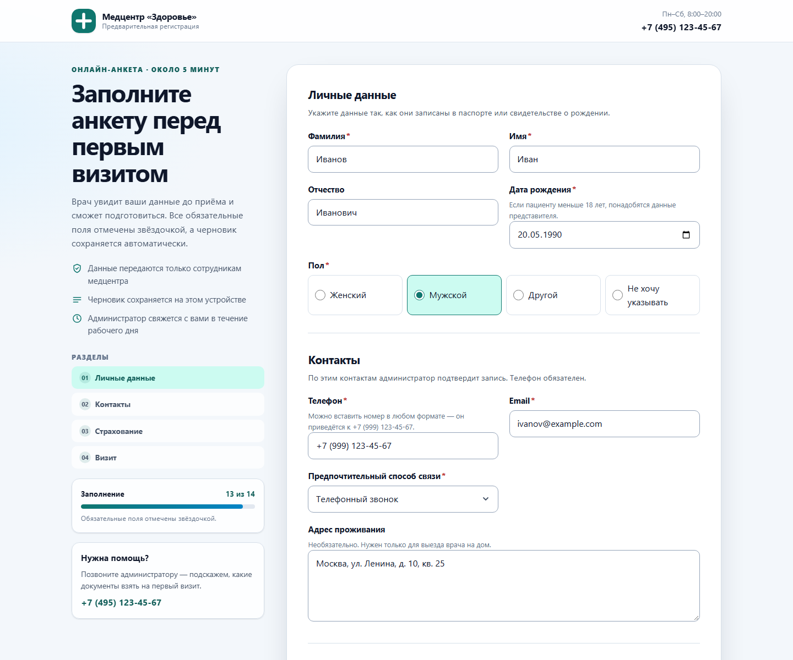
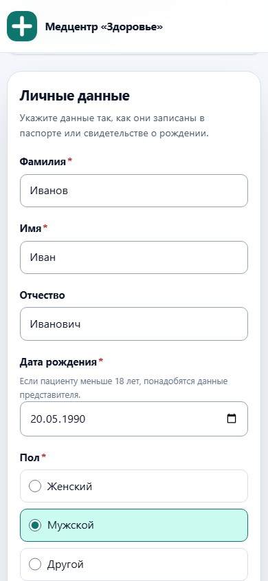

# Анкета пациента — React + TypeScript + REST API

Медицинская анкета для записи на приём: типизированный REST API, клиентская и серверная валидация, маски телефона и полиса, условные поля и автосохранение черновика.

[](https://github.com/VEYMK/medical-intake-react/actions/workflows/ci.yml)



<p>
  
</p>

## Почему я переписал с vanilla JS на React

В vanilla-версии вся логика формы была завязана на DOM: состояние хранилось в самих полях, а условные блоки и ошибки приходилось синхронизировать вручную. После добавления масок, черновика и условных полей стало видно, что изменения в одном месте легко ломают другое, а протестировать поведение без браузера почти невозможно. React позволил описать форму как данные: схема, типизированное состояние и чистые функции валидации, а компоненты только отображают это состояние. TypeScript и настоящий REST API довели идею до конца — контракт данных проверяется и на клиенте, и на сервере.

## Запуск

Нужен Node.js 20.19+ или 22.12+.

```bash
npm install
npm start
```

`npm start` собирает фронтенд и поднимает один Express-процесс на <http://localhost:3001> — он отдаёт и UI, и `/api/*`.

Для разработки с горячей заменой модулей:

```bash
npm run dev
```

Vite открывается на <http://localhost:5173> и проксирует `/api` на Express (порт 3001).

## Что умеет

- Четыре раздела: личные данные, контакты, страхование, визит.
- Условные поля: представитель появляется для пациента младше 18 лет, полис и страховая — только при наличии полиса, своя компания — только для варианта «Другая».
- Маски: `+7 (999) 123-45-67` и `1234 5678 9012 3456`, вставка номера в любом формате.
- Валидация на blur и при отправке: имена, email, телефон, даты, полис, симптомы, согласие.
- Ошибки собраны в сводку со ссылками на поля; фокус переходит к первому невалидному полю.
- Черновик сохраняется в `localStorage` (TTL 7 дней), согласие в него никогда не попадает.
- Отправка через `POST /api/patients`, затем список заявок обновляется из `GET /api/patients`.
- Явные состояния загрузки, ошибки и успеха; при сетевой ошибке ответы остаются в черновике.
- Адаптивность от 375 px, клавиатурная навигация, `aria-invalid`/`aria-describedby`, reduced motion, forced colors и печать.

## API

| Метод | Путь | Ответ |
| --- | --- | --- |
| `GET` | `/api/patients` | `{ ok: true, patients: Patient[] }` |
| `POST` | `/api/patients` | `201 { ok: true, reference, patient }` |
| `GET` | `/api/health` | `{ ok: true, service }` |

`POST` возвращает `422` с `{ ok: false, message, fieldErrors }`, если поля не проходят серверную проверку. Сервер не доверяет клиенту: он повторно проверяет обязательные поля, возраст, диапазон даты приёма, полис и согласие.

```bash
curl -X POST http://localhost:3001/api/patients \
  -H "Content-Type: application/json" \
  -d '{"lastName":"Иванов","firstName":"Иван","birthDate":"1990-05-20","gender":"male","phone":"+7 (999) 123-45-67","email":"ivanov@example.com","preferredContact":"phone","hasInsurance":false,"visitReason":"consultation","preferredDate":"2026-11-20","symptoms":"Болит голова и повышено давление.","consent":true}'
```

Данные лежат в `server/data/patients.json` (файл создаётся при первой заявке и не коммитится). Запись атомарная, параллельные запросы выстраиваются в очередь.

## Стек и решения

- **React 19 + TypeScript 7 (strict).** Никакого `any`: ответы API приходят как `unknown` и сужаются до `Patient`/`FormResponse` в `src/api/patients.ts`.
- **Vite 8** для сборки и dev-сервера, **Express 5** для API, **Vitest 5** для тестов.
- **`FormField`, `ValidationMessage`, `SubmitButton`** — переиспользуемые компоненты с типизированными пропсами; `FormField` строится по схеме и умеет текст, select, radio, checkbox, textarea и маски.
- **`useReducer` + `useIntakeForm`** — состояние формы, маски, условная очистка, touched/errors и статус отправки живут в одном редьюсере; хук добавляет черновик и запросы.
- **Один контракт на два приложения.** `Patient` и `PatientInput` описывают и клиент, и сервер; серверная валидация повторяет правила клиента.
- **JSON-файл вместо БД.** Для портфолио важнее запуск одной командой, чем инфраструктура; хранилище изолировано в `server/storage.mjs` и заменяется на настоящую БД без изменений в UI.

```text
src/
  api/patients.ts        типизированный HTTP-клиент и runtime-проверки
  components/            FormField, ValidationMessage, SubmitButton, ErrorSummary, …
  hooks/useIntakeForm.ts состояние, черновик, submit
  lib/                   форматтеры, валидаторы, черновик, payload
  state/intakeReducer.ts редьюсер формы
  schema.ts              секции, поля и условные правила
  types.ts               Patient, PatientInput, FormValues, FormResponse
server/
  index.mjs              маршруты Express и отдача dist/
  validation.mjs         серверная валидация
  storage.mjs            атомарная запись JSON
```

## Тесты и проверки

```bash
npm test          # 47 тестов: клиентские валидаторы, редьюсер, черновик, API-клиент, сервер
npm run typecheck # tsc -b, strict
npm run build     # production-сборка Vite
```

CI (GitHub Actions) запускает все три шага на каждый push и pull request.

## Git

История собрана в командном стиле: `feature/ts-migration`, `feature/api-integration` и `feature/ui-polish` влиты в `main` через `--no-ff`, чтобы этапы читались в `git log --graph --oneline`.

## Старая версия

Vanilla JS + HTML/CSS: [VEYMK/medical-intake-form](https://github.com/VEYMK/medical-intake-form) · [живая демонстрация](https://veymk.github.io/medical-intake-form/).

Оттуда перенесены схема полей, правила валидации, маски, условные блоки и адаптивная вёрстка. Изменились способ хранения состояния, компонентная структура, типизация и отправка: раньше данные никуда не уходили, теперь их принимает REST API и показывает список заявок.

## Ограничения

Демонстрационный проект: нет авторизации, ролей и шифрования, JSON-файл не подходит для реальных персональных данных. Для продакшена нужны БД, аутентификация, аудит доступа и защищённый канал.
